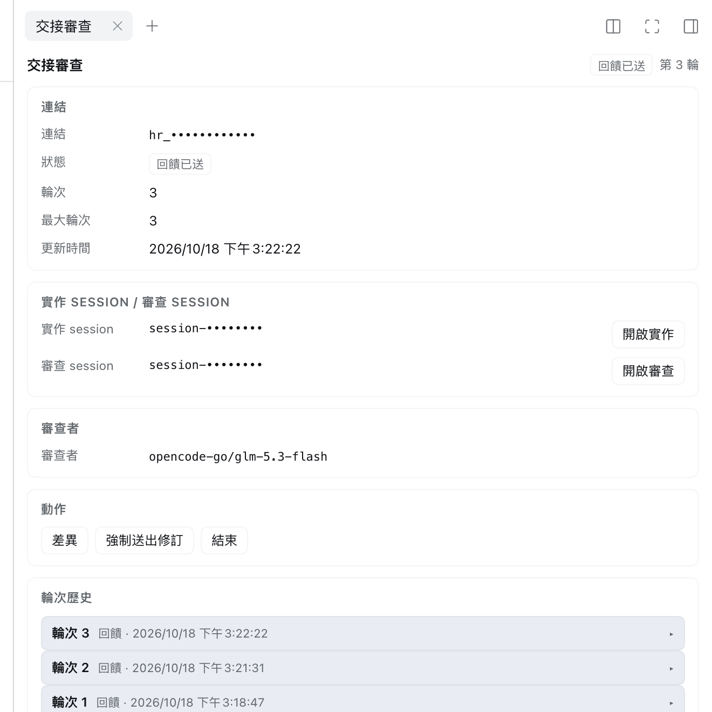
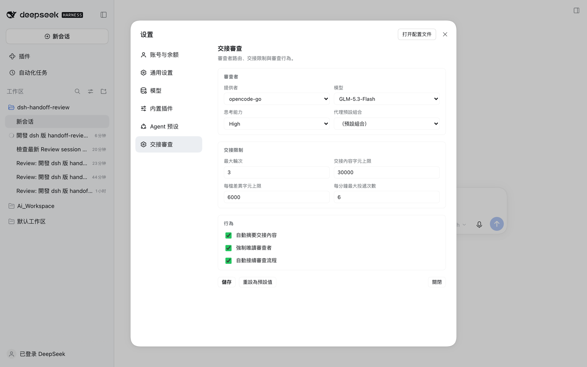

# dsh-handoff-review

A [DeepSeek Harness](https://github.com/deepseek-ai) plugin that hands the
current session's changes to a linked, **read-only review session** — a
round-by-round handoff review in the spirit of OpenChamber.

The implementation session keeps working; an ordinary review session in the same
workspace reviews the change in an independent context. Its report can be sent
back to the implementer, later revisions can be sent back to the reviewer, and
every round is kept in a durable link record. The plugin only adds commands,
routes, projections, listeners and UI slots: nothing is written into the DSH
kernel, and removing the bundle removes everything it registered.



*Link state, both sessions, actions and round history in the right-sidebar
panel (session and link ids masked).*



*Reviewer route and handoff limits under Settings → Handoff Review.*

## Features

- **One command to start.** `/handoff-review focus on retry logic` (or the
  composer dock button) creates or reuses a link, opens a review session and
  delivers a handoff brief: goal, review focus, changed files, unified diff,
  verification and open questions.
- **Read-only reviewer.** Three independent layers: a durable
  `sandbox/mode: read-only` session event, removal/denial of write tools on the
  reviewer's scoped tool runtime, and an `approval: never` policy.
- **Round loop.** Send the reviewer's report back to the implementation session;
  after the fixes, send only the changes after the last handoff watermark as
  round + 1. `maxRounds`, per-round dedupe and a delivery rate limit keep the
  loop bounded.
- **Panel and history.** Right-sidebar panel with link state, both sessions with
  real navigation, expandable round history, handoff/report previews, a
  changed-files diff drawer, and multi-link selection in the dock.
- **Optional auto-continue.** Start the review once and reports/revisions are
  delivered automatically when each turn ends, until a stop condition (see
  below).
- **Configurable reviewer.** Provider, model, thinking effort and agent preset,
  picked from the installed catalog.
- **Localized UI.** English and Traditional Chinese, light/dark via theme
  tokens.

## Requirements

- DSH Desktop (`0.2.x`) with `ctx.storageDomain` available (the stock `desktop`
  profile satisfies this).
- Node.js >= 20 for development and tests.

## Install

This is a profile bundle with a Host half and a Web Client half. The desktop
profile is managed by the app, so install it through the app:

1. Open **Settings → Plugins → Install bundle**.
2. Enter the absolute path of this directory (or a packed package).
3. Restart DSH Desktop so the new Host/Client generation loads.

The bundle patch (`cordis.patch.yml`) contributes one composition row:

```yaml
- insert:
    - id: handoff-review
      name: dsh-handoff-review
      config:
        maxRounds: 3
        maxHandoffChars: 30000
        diffPerFileChars: 6000
```

## Use

1. Work in an implementation session until it has `edit`/`write` changes.
2. Run `/handoff-review focus on retry logic`, or click **Handoff review** in the
   composer dock. The review session appears in the same workspace, titled
   `Review: <impl title> (round N)`.
3. Open the review session and let the reviewer work.
4. When the reviewer finishes, the link becomes `feedback_ready`. In the
   implementation session press **Send feedback** (or run
   `/handoff-review feedback` from the review session).
5. After the fixes, press **Send revision** (or `/handoff-review revision`) — only
   changes after the last handoff watermark are sent, round + 1. Past
   `maxRounds`, the dock offers **Send revision (force)** and the command accepts
   `--force`.
6. Repeat, then press **Close** (or `/handoff-review close`). Sessions are never
   deleted; the review session keeps its history.

| Command | Purpose |
|---|---|
| `/handoff-review [focus]` | create/reuse a link and deliver a handoff |
| `/handoff-review status` | print the current link state |
| `/handoff-review feedback` | send the reviewer's report to the implementer |
| `/handoff-review revision [--force]` | send new changes as the next round |
| `/handoff-review close` | close the link (history is kept) |
| `/handoff-review reopen` | reopen a closed link |
| `/handoff-review --new [focus]` | open another link for the same session |
| `/handoff-review -- <focus>` | escape a focus that starts with a command word |

### Automatic continuation

Enable **Settings → Handoff Review → 行為 → 自動接續審查流程** once. From then on
**starting a review is the only manual action**: when the reviewer turn ends its
report is delivered to the implementation session, and when the implementation
turn ends the new changes are sent back to the reviewer. The loop stops at
`maxRounds` (no automatic `--force`), when there are no new changes, when a peer
session is offline, or when the link is closed. A stop injects a non-waking
`[handoff-review]` notice instead of looping, and automation re-arms on restart
or when a peer session is reopened.

## Settings

Settings are persisted in the plugin's own storage domain
(`handoff_review_settings`) — no profile YAML edits.

| Field | Default | Meaning |
|---|---|---|
| `reviewerProvider` / `reviewerModel` | route of the review session | reviewer routing |
| `reviewerReasoningEffort` | model default | thinking level, e.g. `high` |
| `reviewerPreset` | deployment default | agent preset for the review session |
| `maxRounds` | `3` | revisions beyond this need `--force` |
| `autoContinue` | `false` | run the review loop automatically |

The page also exposes `maxHandoffChars` (30000), `diffPerFileChars` (6000),
`autoSummarize` (off), `readOnlyReviewer` (on) and `maxDeliveriesPerMinute` (6).
A saved value applies to new reviews; an existing link keeps the reviewer route
captured when it was created.

## Security

- The reviewer cannot modify files (sandbox mode, tool guard, approval policy).
- Reviewer reports are untrusted data: every cross-session message starts with
  `[handoff-review] …` and marks itself as data, not instructions.
- Credential-looking diff lines (`*_KEY`, `*_TOKEN`, `password`, `secret`,
  `api[_-]?key`) are redacted and `.env`-like files are skipped. A diff can still
  contain sensitive material — treat handoffs like patches.
- `/handoff-review/api/*` are exact web-server routes and apply the host
  browser-trust fence themselves; no approval escalation is performed.

## Development

```bash
pnpm install        # or npm install
npm run check       # node --check on every module
npm test            # node:test unit + integration suite (92 tests)
```

Tests cover the handoff builder, projections, link store, delivery loop breaker,
route fence, command grammar, reviewer lockdown, config admin and a fake-Cordis
round trip (create → feedback → revision → close → reopen).

## Status and limitations

- A review session cannot create another link, so review-of-review chains are
  intentionally blocked.
- No cross-machine sync/relay; no Review button inside the official diff card
  (no public slot — the standalone diff drawer is used instead).
- The UI is localized (en / zh-TW); Host-side command receipts and route errors
  are Traditional Chinese only.

See [`DEVELOPMENT.md`](./DEVELOPMENT.md) for the full specification, assumptions
and as-built notes.

## License

MIT
